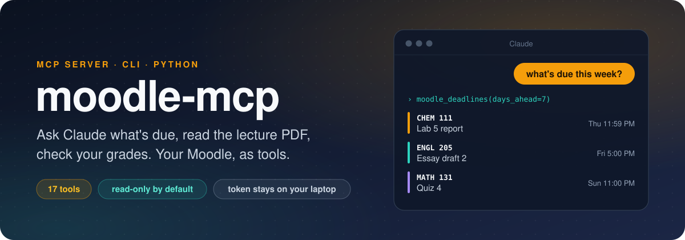
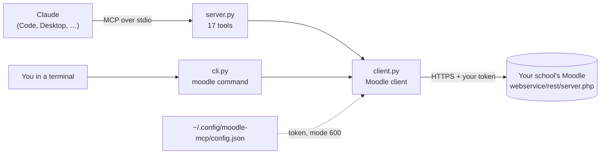

<p align="center">
  
</p>

<p align="center">
  <a href="https://github.com/ralstonraphael/moodle-mcp/actions/workflows/ci.yml"></a>
  
  
  <a href="LICENSE"></a>
</p>

<p align="center">
  <a href="#quick-start">Quick start</a> ·
  <a href="#tools">Tools</a> ·
  <a href="#how-it-works">How it works</a> ·
  <a href="#make-it-your-own">Make it your own</a> ·
  <a href="#privacy-and-safety">Privacy</a> ·
  <a href="#troubleshooting">Troubleshooting</a>
</p>

---

moodle-mcp connects Claude to your Moodle account. From the chat you can ask what's due, have Claude open a reading or pull the text out of lecture slides, or check a grade.

It's about 950 lines of Python running on your own laptop. It signs in with the personal token Moodle gives its phone app and calls the same web-service API the app uses, so Claude sees what you'd see in the app and nothing more. It doesn't scrape pages or ask for your password.

> [!NOTE]
> It defaults to `moodle.trincoll.edu`, but it works with any Moodle site that allows the Moodle mobile app. See [Other schools](#other-schools).

## Things to ask

```text
What's due in the next two weeks? Include anything overdue.
Summarize this week's reading for my chemistry class.
What did my professors post in announcements this week?
Pull the text out of the latest lecture slides and quiz me on it.
What's my current grade in each class?
Find every file in my courses that mentions "midterm".
```

## Quick start

You need [uv](https://docs.astral.sh/uv/), a fast Python installer. Skip this if you already have it.

```bash
# macOS / Linux
curl -LsSf https://astral.sh/uv/install.sh | sh
```

```powershell
# Windows (PowerShell)
powershell -ExecutionPolicy ByPass -c "irm https://astral.sh/uv/install.ps1 | iex"
```

### 1. Install

```bash
uv tool install git+https://github.com/ralstonraphael/moodle-mcp
```

This installs two commands, `moodle` for you and `moodle-mcp` for Claude. If your shell then says `command not found`, run `uv tool update-shell` and open a new terminal.

### 2. Sign in

```bash
moodle auth
```

`moodle auth` explains where to find your token and then asks for it in a hidden prompt. In Moodle, click your avatar and go to Preferences > Security keys, press Reset on the *Moodle mobile web service* row, and copy the key it shows you. [docs/getting-your-token.md](docs/getting-your-token.md) has the full walkthrough and a second method for schools where that page is missing.

```bash
moodle whoami    # prints your name if it worked
moodle due       # what's coming up
```

### 3. Connect Claude

<details open>
<summary><b>Claude Code</b></summary>

```bash
claude mcp add -s user moodle -- moodle-mcp
```

Start a new Claude Code session and ask *"what's due this week?"*.

</details>

<details>
<summary><b>Claude Desktop</b></summary>

Open Settings > Developer > Edit Config and add the server:

```json
{
  "mcpServers": {
    "moodle": {
      "command": "/Users/YOUR-NAME/.local/bin/moodle-mcp"
    }
  }
}
```

Put in the full path that `which moodle-mcp` prints (on Windows, `where moodle-mcp`, with each `\` written as `\\` in the JSON). Desktop apps don't always inherit your terminal's PATH, so a bare `moodle-mcp` may not be found. Quit and reopen Claude Desktop afterwards.

</details>

<details>
<summary><b>Any other MCP client</b></summary>

moodle-mcp is a standard stdio MCP server. Any client that can launch a local server can run it if you point it at the `moodle-mcp` command with no arguments.

</details>

## Tools

| Tool | What it does |
| --- | --- |
| `moodle_deadlines` | Upcoming and overdue assignments and quizzes from your timeline |
| `moodle_courses` | Your courses and their ids |
| `moodle_course_contents` | Every section, activity, file and link in a course, with the section notes |
| `moodle_search` | Find activities, files and section text that mention a word |
| `moodle_assignments` | All assignments, sorted by due date, with submission status and grade |
| `moodle_assignment` | One assignment in full: instructions, attachments, time left, feedback |
| `moodle_read` | Open any page, file, folder, link, forum or quiz by its id |
| `moodle_file_text` | Text out of a PDF, Word, PowerPoint, Excel, HTML or plain-text file |
| `moodle_download` | Save a course file to `~/Downloads/Moodle` |
| `moodle_grades` | Grade items for one course, or totals for all of them |
| `moodle_announcements` | Latest posts in each course's Announcements forum |
| `moodle_discussion` | Every post in one forum thread |
| `moodle_notifications` | The bell-icon notifications: grades, feedback, reminders |
| `moodle_whoami` | Check the connection |
| `moodle_functions` | List the raw API functions your token is allowed to call |
| `moodle_call` | Call any of those functions directly (the escape hatch) |
| `moodle_submit_assignment` ⚠️ | Save a submission. Stays a draft unless you say to finalise |

## The `moodle` command

The `moodle` command covers most of the same ground from a terminal, though submitting and forum threads are Claude-only. Put `--json` before any command for raw output.

```text
moodle due [--days 14] [--back 14]    upcoming + overdue
moodle courses [inprogress|future|past|all]
moodle assignments [COURSE_ID]        with submission status and grade
moodle contents COURSE_ID             sections + activities
moodle read CMID                      open any activity by its id
moodle grades [COURSE_ID]
moodle file FILEURL                   print a file's text
moodle download FILEURL [--to DIR]
moodle news | notifications | search QUERY
moodle functions [FILTER]             what your token can call
moodle call WSFUNCTION '{"json": "params"}'
moodle logout                         delete the saved token
```

Sample output, with made-up courses:

```console
$ moodle due --days 7
Thu Oct 22 2026 11:59 PM   CHEM 111             Lab 5 report
                           https://moodle.example.edu/mod/assign/view.php?id=4821
Fri Oct 23 2026 5:00 PM    ENGL 205             Essay draft 2
                           https://moodle.example.edu/mod/assign/view.php?id=4907
Sun Oct 25 2026 11:00 PM   MATH 131             Quiz 4
                           https://moodle.example.edu/mod/quiz/view.php?id=5012
```

> [!TIP]
> A course id is the number in `course/view.php?id=…`, and a cmid is the number in any `mod/<type>/view.php?id=…` link. Claude looks these up on its own, so you only need them for the CLI.

## How it works



Each request is a POST to Moodle's [web-service API](https://docs.moodle.org/dev/Web_service_API_functions) carrying your token and a function name, such as `mod_assign_get_assignments`.

| File | Job |
| --- | --- |
| [`client.py`](src/moodle_mcp/client.py) | One `call()` that POSTs to Moodle's REST endpoint, plus helpers that cut each response down to the fields worth reading (a single calendar event comes back with about 50). It also turns HTML into text and pulls text out of PDF, DOCX, PPTX and XLSX files. |
| [`server.py`](src/moodle_mcp/server.py) | Wraps those helpers as MCP tools with [FastMCP](https://github.com/modelcontextprotocol/python-sdk). Claude reads each tool's docstring to decide when to call it, so the docstrings do real work. |
| [`cli.py`](src/moodle_mcp/cli.py) | The `moodle` command, built on the same client, for testing without Claude. |

## Make it your own

To add a tool, clone the repo and install it in editable mode so your commands run the code you're changing:

```bash
git clone https://github.com/ralstonraphael/moodle-mcp && cd moodle-mcp
uv tool install --force --editable .

moodle functions calendar                # 1. find an API function
moodle call core_calendar_get_calendar_upcoming_view '{}'   # 2. see what it returns
```

3. Add a method to `client.py` that calls it and keeps the useful fields.
4. Add a `@mcp.tool` function in `server.py` with a clear docstring.
5. Restart your Claude session and try it.

[docs/extending.md](docs/extending.md) walks through that calendar example line by line and ends with a list of ideas to build next. In Claude Code, the repo's [`CLAUDE.md`](CLAUDE.md) describes the layout, so you can open the folder and ask for something like *"add a tool that lists my upcoming calendar events"*.

<details>
<summary><b>Dev loop</b></summary>

```bash
uv run pytest                                          # offline tests, no Moodle needed
uvx ruff check .                                       # lint
npx @modelcontextprotocol/inspector moodle-mcp         # click through the tools in a browser
```

</details>

## Privacy and safety

- Your token sits in `~/.config/moodle-mcp/config.json`, readable only by your user account, and goes nowhere except your school's Moodle. `moodle logout` deletes it.
- The token can do anything the Moodle app can do as you, so keep it out of chats, group messages and repos. If it leaks, press Reset on the Security keys page and the old one stops working.
- Anything a tool returns becomes part of your conversation with Claude, the same as text you paste in yourself.
- Three tools can change things. `moodle_download` saves a file to your computer, while `moodle_submit_assignment` and `moodle_call` can write to Moodle. The other fourteen only read.
- `moodle_submit_assignment` saves a draft unless you tell it to finalise, and its instructions tell Claude to show you the exact content before sending it.
- Check your course's AI policy before you use this on graded work.

## Troubleshooting

| Problem | Fix |
| --- | --- |
| `invalidtoken`, or "the token is missing or expired" | Press Reset on the Security keys page and run `moodle auth` again |
| No *Moodle mobile web service* row on Security keys | Sign in to the Moodle phone app once, then refresh the page |
| `moodle: command not found` | Run `uv tool update-shell` and open a new terminal |
| Claude doesn't list the tools | Start a new session after adding the server. In Claude Desktop, use the full path to `moodle-mcp` |
| `accessexception` on one tool | Your school has switched that function off. `moodle functions` shows what's allowed |
| A file says it can't extract text | Use `moodle download` and open the file instead |

## Other schools

```bash
moodle auth --url https://moodle.yourschool.edu
```

Your school's Moodle has to allow the mobile app, so if the Moodle phone app signs you in, this will work too. Setting the `MOODLE_URL` and `MOODLE_TOKEN` environment variables works in place of `moodle auth`.

## License

[MIT](LICENSE). Not affiliated with Moodle Pty Ltd or any school.
